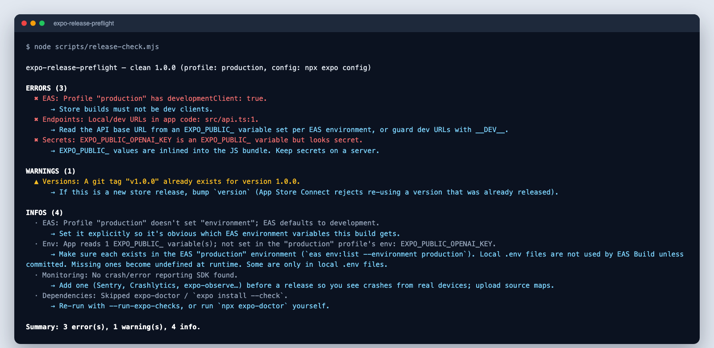

# expo-ship-kit

Four [Agent Skills](https://agentskills.io) that take an Expo / React Native app from "it works on my
phone" to "it's live in both stores" — and keep it there.



| Skill | Ask it… | What it brings |
|---|---|---|
| **expo-release-preflight** | "Cutting the production build tonight — anything that'll bite me?" | `release-check.mjs`: gitignored assets that won't upload, committed `ios/`/`android/` that silently ignore app.json, localhost URLs and leaked keys, EAS environment vs `EXPO_PUBLIC_` usage, versions, channels, runtimeVersion, optional expo-doctor. Release smoke-test checklist. |
| **eas-build-submit** | "My EAS build failed in Run fastlane" · "Set up CI for this app" | `diagnose-build-log.mjs`: matches ~30 known build/submit failures (pods, signing, Gradle, JS bundling, OOM, ITMS errors, Play draft app, versionCode reuse…) earliest-first. `check-eas-config.mjs`: validates eas.json, submit profiles, committed credentials, rollouts, workflows. Annotated eas.json, submit guides, EAS Workflows examples. |
| **expo-ota-updates** | "Can I ship this fix as an update tonight?" | `ota-or-build.mjs`: diffs two git refs and says OTA / needs a build / verify, with reasons (native deps checked in node_modules, native app.json keys, plugins, patches, icons). Runtime version policies, channels, `--environment`, rollouts and rollbacks. |
| **app-store-review-guard** | "Will Apple reject this?" · "Rejected under 4.8, what now?" · "Write my review notes" | `preflight.mjs`: permission strings, privacy manifest, ATT, account deletion, Sign in with Apple, IAP vs Stripe, third-party AI consent, hidden features (2.5.19), target API 36, sensitive Android permissions, icon alpha. Rejection playbook and review-notes template. |

Every script is zero-dependency Node (18+), prints a human report or `--json`, and exits non-zero on
blockers — so they work in CI as well as inside an agent.

## Install

**Claude Code (plugin):**

```text
/plugin marketplace add disconnectuss/expo-ship-kit.skills
/plugin install expo-ship-kit@expo-ship-kit
```

Skills are then available as `/expo-ship-kit:expo-release-preflight` etc., and trigger automatically
when relevant.

**Any agent that reads SKILL.md** (Codex CLI, Cursor, Gemini CLI, Claude Code without plugins…):

```bash
npx skills add disconnectuss/expo-ship-kit.skills
```

or copy a folder from `skills/` into your agent's skills directory (e.g. `~/.claude/skills/`).

**Claude.ai and skill marketplaces:** download a skill zip from the [latest release](https://github.com/disconnectuss/expo-ship-kit.skills/releases/latest)
and upload it as a custom skill, or zip a folder from `skills/` yourself.

**Agensi (via MCP, free):** [expo-release-preflight](https://www.agensi.io/skills/expo-release-preflight) ·
[eas-build-submit](https://www.agensi.io/skills/eas-build-submit-doctor-for-expo) ·
[expo-ota-updates](https://www.agensi.io/skills/expo-ota-updates-ship-or-build) ·
[app-store-review-guard](https://www.agensi.io/skills/app-store-rejection-guard-for-expo)

## Run the scripts directly

```bash
node skills/expo-release-preflight/scripts/release-check.mjs --run-expo-checks
node skills/eas-build-submit/scripts/check-eas-config.mjs
node skills/eas-build-submit/scripts/diagnose-build-log.mjs build.log
node skills/expo-ota-updates/scripts/ota-or-build.mjs --base v1.4.0
node skills/app-store-review-guard/scripts/preflight.mjs
```

Run them from your Expo project root (or pass `--project <dir>`).

## Freshness

Store rules and EAS behaviour change several times a year. Everything here was checked on
**29 Oct 2026** against Apple's App Review Guidelines (16 Oct 2026) and upcoming requirements, Google
Play Console Help, Expo SDK 58 and the EAS docs. The store rules, the latest Expo SDK, EAS CLI's `env`
commands and EAS build images were re-checked on **22 Nov 2026**, and every Expo / EAS reference on
**23 Nov 2026**. Each `SKILL.md` carries `metadata.rules-checked-on`.
PRs that update a rule should cite the official source and bump that date.

## Tests

The scripts have deterministic tests against the eval fixtures (no dependencies, runs in CI):

```bash
node --test tests/scripts.test.mjs
```

`evals/` holds one or more agent test cases per skill in the format `claude plugin eval` reads,
including a clean project that must not be flagged:

```bash
claude plugin eval . --allow-tools Bash,Write,Edit --scaffold
claude plugin eval . --allow-tools Bash,Write,Edit --scaffold --tag app-store-review-guard --runs 1
```

### Measured results (23 Nov 2026)

From the [`eval` workflow](.github/workflows/eval.yml) (manual trigger, macOS runner): Claude Sonnet 5.5
as the agent, default haiku judge, one run per cell, kit 0.1.5. The agent had a working shell and ran
`preflight.mjs` / `release-check.mjs` in the three cases that ship a project; the other cases are a
pasted log or a question, so no script applied. The workflow fails if the agent's shell was blocked.

| Case | Without kit | With kit |
|---|---|---|
| audit-clean-expo-project | 0.33 | 0.67 (verdict "Ready") |
| audit-flags-risky-expo-project | 0.83 | 1.00 |
| ota-hotfix-vs-native-change | 0.67 | 1.00 |
| release-preflight-finds-config-traps | 1.00 | 1.00 |
| build-submit-diagnoses-play-draft | 1.00 | 1.00 |
| review-notes-ev-charging-app | 1.00 | 1.00 |
| triage-login-services-rejection | 1.00 | 1.00 |

Single runs vary (a local run with Opus 5.5 the same day scored release-preflight 0.75 without the kit
and triage 0.67 on both arms), so read the numbers as a direction, not a benchmark.

## License

MIT © Fatma Aktas
